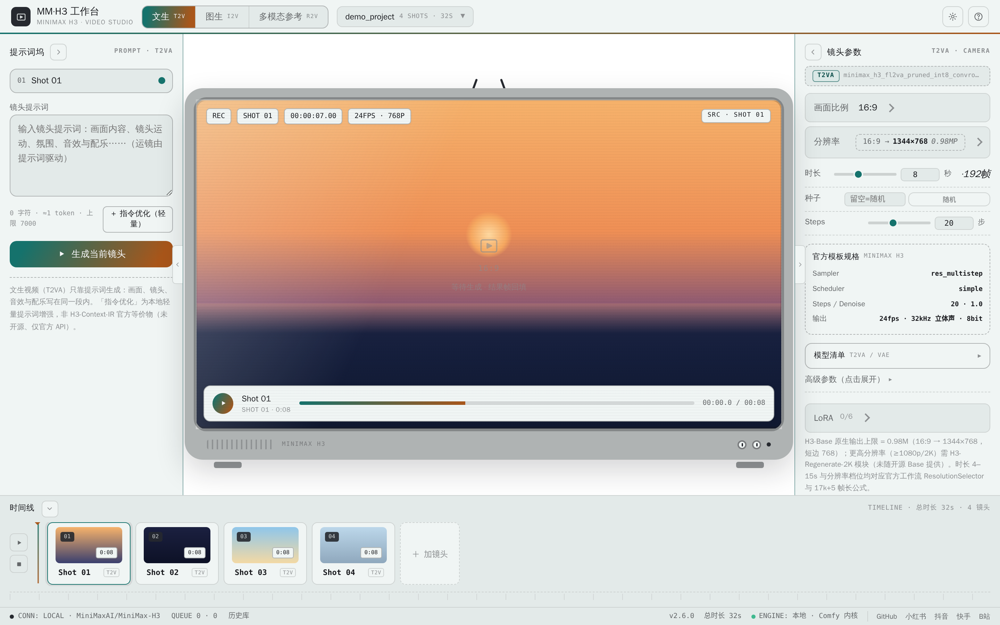
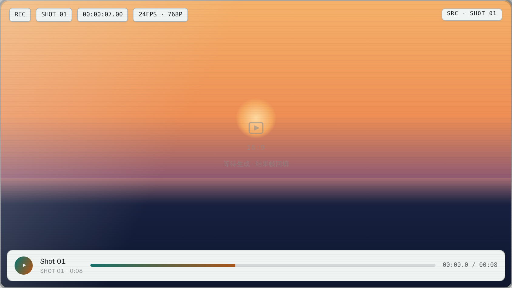
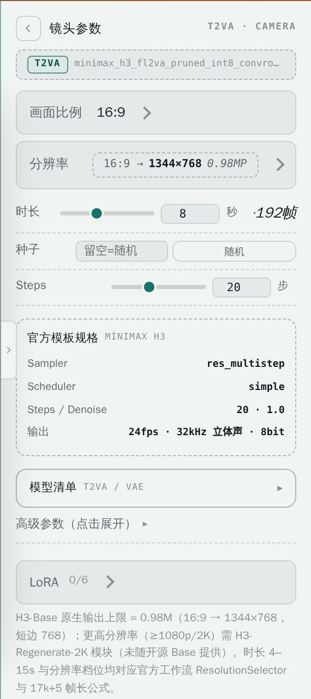
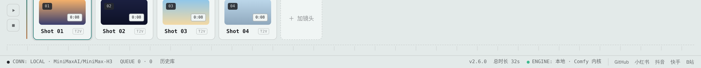
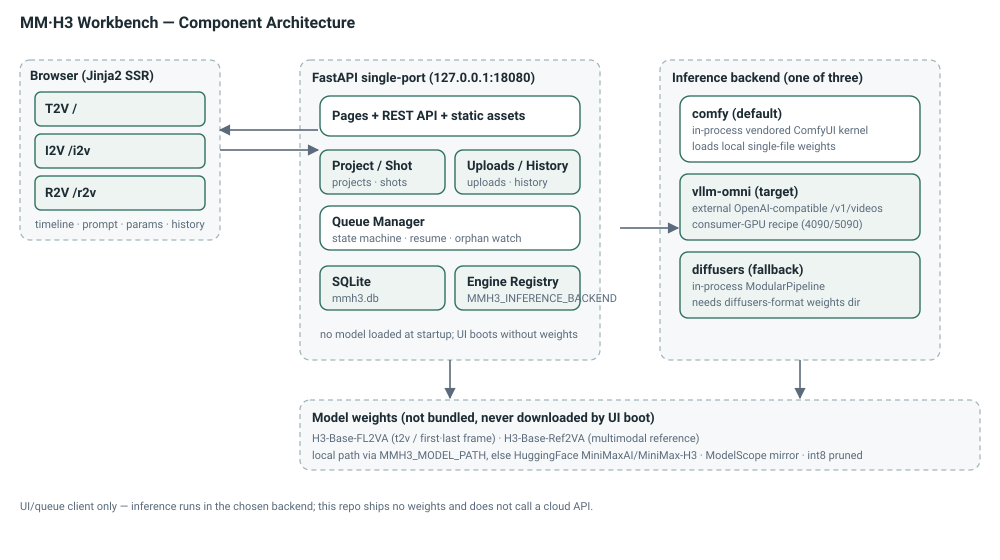

# MM·H3 工作台 · MiniMax H3 Video Timeline Workbench

> A local, single-host video-generation timeline studio for the **MiniMax H3** open model: arrange shots on a multi-shot timeline, feed prompts / parameters / reference media, and call a local MiniMax H3 inference backend to render each shot with inline preview.

[](https://github.com/ReSerendipity/MiniMax-H3-Lite/actions/workflows/test.yml)
[](https://github.com/ReSerendipity/MiniMax-H3-Lite/releases/latest)
[](https://www.python.org/)
[](https://nodejs.org/)
[](#许可证--license)
[](https://github.com/ReSerendipity/.github/blob/main/CONTRIBUTING.md)
[](https://github.com/ReSerendipity/.github/tree/main/governance)

**[中文](#中文) | [English](#english)**

---

## 中文

### 项目简介

MM·H3 工作台是一个面向开发者的**本地视频生成时间线工作台**：在多镜头时间线上编排项目，输入提示词 / 参数 / 参考素材，调用本地 **MiniMax H3**（H3-Base）推理服务逐镜头生成视频并即时预览成片。

前端按官方三份 ComfyUI 工作流拆分为**三个模式页**——文生 T2V（`/`）、图生 I2V（`/i2v`，首帧 / 末帧 / 首尾帧）、多模态参考 R2V（`/r2v`），由 **FastAPI + Jinja2 单端口**服务端渲染（`backend/templates/`），顶栏一键切换；明暗双主题，响应式布局。

它只是一个 **UI / 队列客户端**：依赖一个本机可达的 MiniMax H3 推理后端（进程内 `comfy` 内核、外部 `vllm-omni` OpenAI 兼容端点，或 `diffusers` 进程内管线三选一）。2K（H3-Regenerate-2K）官方尚未开源，UI 中对应选项已禁用。

### 核心特性

- **三模式页**：T2V / I2V（首·末·首尾帧 + 图像槽位）/ R2V（参考素材管理器 + 标签速查），顶栏切换互跳、当前页高亮。
- **官方参数规格**：六种宽高比 + 768P 短边（上限 768×1344、32 倍数）实时像素换算；时长 4–15s 整数秒（默认 8s）按 17k+5 帧网格显示帧数；噪声种子留空即随机。
- **多模态参考（REF2VA）**：图 ≤9 / 视频 ≤3 / 音频 ≤3，混合 ≤12；参考保真度 match/max；提示词按官方标签（`<Picture N>` / `<Video N>` / `<Audio N>`、`<d>[语言]`）引导书写。
- **输入校验**：格式 / 大小 / 数量上限 / 音频须配图或视频 / 音视频每段 2–15s、同类合计 ≤15s，超限 422 且不留孤儿文件。
- **生成队列与状态流转**：任务状态机、断点续跑、历史库回看、多项目管理、推理引擎运行时切换。
- **展示壳与主题**：剧场红 / 放映机青绿双展示壳，首访引导 + 本地持久化，顶栏外观菜单随时切换。

### 界面展示

**主界面（文生 T2V 工作台）**——顶栏三模式切换、左侧提示词坞、中央放映机预览、右侧镜头参数、底部多镜头时间线：



**结果回投区（等待生成）**——生成完成后视频会在此即时回放；当前为空态，可见 REC / 时间码 / 24FPS·768P 角标与播放控制条：



**镜头参数面板**——画面比例、实时分辨率换算、时长 / 帧数、种子、Steps，以及官方模板规格（Sampler / Scheduler / 输出规格）：



**时间线与队列状态栏**——多镜头缩略条、总时长统计，状态栏实时显示连接状态、`QUEUE 待处理·进行中`计数、应用版本与当前推理引擎：



**组件架构**——浏览器（Jinja2 SSR）→ FastAPI 单端口（页面 + API + SQLite + 队列）→ 三选一推理后端 → 本地权重：



### 快速开始

> 受支持运行时：**Python 3.12** 与 **Node 22**（与 CI 同版本）。本仓库是 UI / 队列客户端，**不内置、不下载模型权重**；真实推理前需自行准备 MiniMax H3 权重（见下文「系统要求」）。仅启动界面与跑通 UI 不需要 GPU。

#### 1. 克隆后必做（本地门禁，一次性）

```bash
sh .githooks/install.sh             # 启用本仓库钩子
sh .githooks/install.sh --check     # 只读自检：未启用则退出码 1 并说明失效了哪些防线
```

`core.hooksPath` 是本地 git 配置，不随克隆传播。未启用时，gitleaks 密钥扫描、DCO 签名与推送前预检都不会执行。

#### 2. 安装依赖

```bash
python -m venv .venv && source .venv/bin/activate   # Windows: .venv\Scripts\activate
pip install -r requirements.txt
```

#### 3. 启动

Windows 一键启动（自动探测 Python → 启动 FastAPI → 打开浏览器）：

```bat
start.bat
```

跨平台手动启动：

```bash
python -m uvicorn backend.main:app --port 18080
```

页面地址：`http://127.0.0.1:18080/`（T2V）、`/i2v`（I2V）、`/r2v`（R2V）。端口可用环境变量 `MMH3_PORT` 覆盖。

#### 4. 最小验证（不触发推理）

```bash
curl -s http://127.0.0.1:18080/api/health | python -m json.tool
# status=ok、model_loaded=false 即说明 UI 与 API 已就绪（此时未加载任何权重）
```

浏览器打开 `http://127.0.0.1:18080/`，接受用户协议后即可浏览三模式页、参数面板与时间线——不点击「生成当前镜头」就不会发起推理。

#### Docker 部署（可选，适合 Linux / GPU 服务器）

```bash
sudo scripts/preflight.sh                       # 目录与模型文件权限预检
python scripts/check_compose_mounts.py          # 检查 5 个 compose 挂载源
docker compose up -d --build                    # 构建并启动
curl -s http://127.0.0.1:18080/api/health       # 健康检查
```

> 镜像**不含** `comfy_kernel/`（ComfyUI 内核，GPL-3.0）；经 compose 部署时自动以只读方式挂载。compose 默认仅绑定 `127.0.0.1:18080`，切勿改为 `0.0.0.0` 后裸奔——本工作台 API 无内置认证。

### 系统要求与兼容性

- **运行时**：Python 3.12、Node 22；SQLite（随 Python 自带）。
- **界面 / 开发**：任意现代浏览器，无需 GPU 即可启动 UI 与跑测试。
- **真实推理（三选一，经 `MMH3_INFERENCE_BACKEND` 切换）**：
  - `comfy`（默认）：进程内 vendored ComfyUI 内核，加载本地单文件权重。
  - `vllm-omni`（目标）：外部 vllm-omni 服务（Apache-2.0，OpenAI 兼容 `/v1/videos`），消费者级 GPU recipe（4090/5090 已验证）；需配置 `MMH3_VLLM_OMNI_ENDPOINT`。
  - `diffusers`（回退）：进程内 `ModularPipeline`，需 diffusers 格式权重目录。
- **模型权重**：本地路径经 `MMH3_MODEL_PATH` 指定，留空则从 HuggingFace `MiniMaxAI/MiniMax-H3` 拉取；国内优先魔搭 `MiniMax/MiniMax-H3`。显存有限建议 int8 pruned 权重 + `MMH3_QUANTIZATION`。
- **已知边界**：2K（H3-Regenerate-2K）与 H3-Context-IR 官方未开源，前端选项已禁用或为本地轻量替代；参考视频同步音轨、采样器覆盖在 diffusers 后端会降级（详见仓库 `README` 历史版与 `docs/`）。

### 使用示例

- **文生视频**：在 `/` 页新建项目 → 时间线「+ 加镜头」→ 左侧写提示词（≤7000 字符）→ 右侧选比例 / 时长 / 种子 → 「生成当前镜头」。
- **图生视频**：切到 `/i2v`，选首帧 / 末帧 / 首尾帧模式并上传图像，可开启「跟随首帧尺寸」。
- **多模态参考**：切到 `/r2v`，上传 ≤12 个混合参考素材（图 / 视频 / 音频），按 `<Picture N>` / `<Video N>` / `<Audio N>` 标签书写提示词。
- **跑测试**：

```bash
python -m pytest tests/ -q          # 后端单测（公式一致性、上传校验、时长校验）
npm run test:frontend                # 前端 jsdom 交互断言
```

### 常见问题（FAQ）

1. **启动后点生成没反应 / 报后端错误？** 本工作台不含权重。请先确认已按「系统要求」准备好推理后端与权重，并访问 `/api/health` 查看 `dependency.reachable` 与 `model_loaded`。
2. **端口 18080 被占用？** 用 `MMH3_PORT=其它端口 python -m uvicorn backend.main:app --port 其它端口` 覆盖。
3. **为什么没有 2K / 1080p 选项？** H3-Regenerate-2K 尚未随官方开源，UI 已禁用；当前 H3-Base 原生上限 0.98MP（16:9 → 1344×768）。
4. **可以直接对外暴露公网吗？** 不建议。API 无内置认证；如需外网访问，请置于反向代理之后并加鉴权。
5. **Windows 下 Docker 容器读不到权重？** 参考 `pwsh scripts/convert_model_junctions.ps1`（默认 dry-run，需约 213GB 磁盘峰值）。

### 文档与治理

- 架构决策：`docs/adr/`（单端口 FastAPI、内嵌 comfy 内核、vllm-omni 引擎、版本治理）。
- 合规与安全：`docs/GPL_COMPLIANCE.md`、`docs/MODEL_LICENSE.md`、`docs/SECURITY.md`、`docs/THIRD_PARTY_NOTICES.md`。
- 运维：`docs/SRE_RUNBOOK.md`、`docs/rollback_sop.md`。
- 治理规范：[ReSerendipity/.github/governance](https://github.com/ReSerendipity/.github/tree/main/governance)。

### 贡献、安全与支持

- 贡献请遵循[组织级贡献指南](https://github.com/ReSerendipity/.github/blob/main/CONTRIBUTING.md)（Conventional Commits + DCO 签名），欢迎 PR。
- 安全问题请按 `docs/SECURITY.md` 披露，勿公开开 Issue。

### 许可证

项目**代码**采用 Apache License 2.0 开源；MiniMax H3 **模型权重**遵循 MiniMax 官方社区许可（含地域条款），商用 / 再分发 / 微调前请阅读 `docs/MODEL_LICENSE.md` 与官方协议。

---

## English

### Introduction

MM·H3 Workbench is a **local, single-host video-generation timeline studio** for the open **MiniMax H3** model: arrange shots on a multi-shot timeline, feed prompts / parameters / reference media, and call a local MiniMax H3 inference backend to render each shot with inline preview.

The frontend splits the three official ComfyUI workflows into mode pages — **T2V** (`/`), **I2V** (`/i2v`, first / last / both frames) and **R2V** (`/r2v`, multimodal reference manager) — served by a **FastAPI + Jinja2 single-port** backend (`backend/templates/`), with light/dark themes and a responsive layout.

It is a UI/queue client only: it depends on a locally reachable MiniMax H3 inference backend — an in-process `comfy` kernel, an external `vllm-omni` OpenAI-compatible endpoint, or an in-process `diffusers` pipeline. 2K (H3-Regenerate-2K) is **not yet open-sourced by MiniMax** and stays disabled in the UI.

### Key Features

- **Three mode pages**: T2V / I2V (first·last·both frames + image slots) / R2V (reference-asset manager + tag cheat-sheet), with top-bar switching and active-tab highlight.
- **Official parameter spec**: six aspect ratios + 768P short edge (max 768×1344, multiple of 32) with live pixel conversion; 4–15s integer duration (default 8s) on the 17k+5 frame grid; blank seed = random.
- **Multimodal reference (REF2VA)**: up to 9 images / 3 videos / 3 audios, ≤12 mixed; reference fidelity match/max; prompts guided by official tags (`<Picture N>` / `<Video N>` / `<Audio N>`).
- **Input validation**: format / size / count limits, audio must accompany image or video, clips 2–15s each and ≤15s per kind — rejected with 422 and no orphan files.
- **Generation queue & state machine**: task status flow, checkpoint resume, history playback, multi-project management, runtime engine switch.
- **Display shells & themes**: cinema-red / projector-teal shells, first-run guide, persisted locally, switchable from the appearance menu.

### Screenshots

**Main workbench (T2V)** — top mode tabs, left prompt dock, center projector preview, right shot parameters, bottom multi-shot timeline:


**Result playback area (waiting for generation)** — finished video plays back inline here once rendering completes; shown in its empty state, with REC / timecode / 24FPS·768P badges and a transport bar:


**Shot parameter panel** — aspect ratio, live resolution conversion, duration / frame count, seed, steps, and official-template spec (Sampler / Scheduler / output format):


**Timeline & queue status bar** — shot thumbnails, total duration, and a status bar showing connection, `QUEUE pending·running` count, app version and active inference engine:


**Component architecture** — browser (Jinja2 SSR) → FastAPI single port (pages + API + SQLite + queue) → one of three inference backends → local weights:


### Quick Start

> Supported runtimes: **Python 3.12** and **Node 22** (matching CI). This repo is a UI/queue client and **ships no model weights**. Real inference requires you to prepare MiniMax H3 weights first (see System Requirements). Booting the UI and running tests needs no GPU.

#### 1. One-time local gates

```bash
sh .githooks/install.sh             # install repo hooks
sh .githooks/install.sh --check     # read-only self-check (exit 1 if hooks are missing)
```

`core.hooksPath` is local-only and does not propagate on clone; without it, gitleaks secret scanning and DCO signing are not enforced.

#### 2. Install dependencies

```bash
python -m venv .venv && source .venv/bin/activate
pip install -r requirements.txt
```

#### 3. Run

Windows one-click:

```bat
start.bat
```

Cross-platform manual:

```bash
python -m uvicorn backend.main:app --port 18080
```

Pages: `http://127.0.0.1:18080/` (T2V), `/i2v` (I2V), `/r2v` (R2V). Override the port with `MMH3_PORT`.

#### 4. Minimal smoke check (no inference)

```bash
curl -s http://127.0.0.1:18080/api/health | python -m json.tool
# status=ok with model_loaded=false means UI + API are up (no weights loaded yet)
```

Open `http://127.0.0.1:18080/`, accept the EULA, and browse all three mode pages, the parameter panel and the timeline — no inference starts until you click "Generate".

#### Docker (optional, for Linux / GPU servers)

```bash
sudo scripts/preflight.sh
python scripts/check_compose_mounts.py
docker compose up -d --build
curl -s http://127.0.0.1:18080/api/health
```

> The image does **not** bundle `comfy_kernel/` (GPL-3.0); compose mounts it read-only. Compose binds `127.0.0.1:18080` only — never expose it on `0.0.0.0` without a reverse proxy and auth, as the API has no built-in authentication.

### System Requirements & Compatibility

- **Runtimes**: Python 3.12, Node 22; SQLite (bundled with Python).
- **UI / development**: any modern browser; no GPU needed to boot the UI or run tests.
- **Real inference (pick one via `MMH3_INFERENCE_BACKEND`)**:
  - `comfy` (default): in-process vendored ComfyUI kernel loading a local single-file weight.
  - `vllm-omni` (target): external vllm-omni service (Apache-2.0, OpenAI-compatible `/v1/videos`), consumer-GPU recipe (4090/5090 verified); set `MMH3_VLLM_OMNI_ENDPOINT`.
  - `diffusers` (fallback): in-process `ModularPipeline` needing a diffusers-format weights directory.
- **Weights**: set `MMH3_MODEL_PATH` to a local path, otherwise it pulls from HuggingFace `MiniMaxAI/MiniMax-H3`; in China use the ModelScope mirror `MiniMax/MiniMax-H3`. For limited VRAM, use the int8 pruned weights and set `MMH3_QUANTIZATION`.
- **Known limits**: 2K (H3-Regenerate-2K) and H3-Context-IR are not yet open-sourced and are disabled or lightly approximated in the UI; reference-video synced audio and sampler overrides degrade on the diffusers backend.

### Usage Examples

- **Text-to-video**: on `/` create a project → "+ Add shot" on the timeline → write a prompt (≤7000 chars) on the left → pick aspect / duration / seed on the right → "Generate current shot".
- **Image-to-video**: switch to `/i2v`, choose first / last / both-frames mode and upload images; enable "follow first-frame size" as needed.
- **Multimodal reference**: switch to `/r2v`, upload ≤12 mixed reference assets (image / video / audio) and write prompts with `<Picture N>` / `<Video N>` / `<Audio N>` tags.
- **Tests**:

```bash
python -m pytest tests/ -q          # backend unit tests (formulas, upload validation, duration)
npm run test:frontend                # frontend jsdom interaction tests
```

### FAQ

1. **Generate does nothing / backend errors?** This workbench ships no weights. Prepare an inference backend and weights per System Requirements, then check `/api/health` for `dependency.reachable` and `model_loaded`.
2. **Port 18080 is taken?** Override with `MMH3_PORT=<port> python -m uvicorn backend.main:app --port <port>`.
3. **Why no 2K / 1080p option?** H3-Regenerate-2K is not yet open-sourced; H3-Base tops out at 0.98MP (16:9 → 1344×768).
4. **Can I expose this to the public internet?** Not without care — the API has no auth. Put it behind a reverse proxy with authentication first.
5. **Docker on Windows cannot see weights?** See `pwsh scripts/convert_model_junctions.ps1` (dry-run by default; ~213GB peak disk needed).

### Docs & Governance

- Architecture decisions: `docs/adr/` (single-port FastAPI, embedded comfy kernel, vllm-omni engine, version governance).
- Compliance & security: `docs/GPL_COMPLIANCE.md`, `docs/MODEL_LICENSE.md`, `docs/SECURITY.md`, `docs/THIRD_PARTY_NOTICES.md`.
- Operations: `docs/SRE_RUNBOOK.md`, `docs/rollback_sop.md`.
- Governance: [ReSerendipity/.github/governance](https://github.com/ReSerendipity/.github/tree/main/governance).

### Contributing, Security & Support

- Follow the [org contributing guide](https://github.com/ReSerendipity/.github/blob/main/CONTRIBUTING.md) (Conventional Commits + DCO sign-off). PRs welcome.
- For security issues, please disclose per `docs/SECURITY.md` rather than opening a public issue.

### License

Project **code** is released under Apache License 2.0. MiniMax H3 **model weights** are governed by the MiniMax Community License (including territory terms); read `docs/MODEL_LICENSE.md` and the official terms before commercial use, redistribution, or fine-tuning.
